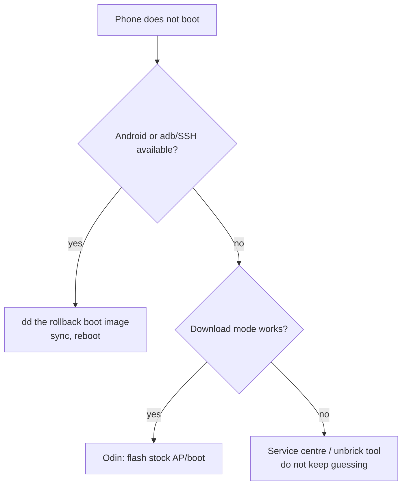

# Build and flash

This is the complete boot-image workflow: dump, unpack, patch, pack, verify,
flash, and roll back. It assumes the vendor boot layout used by the SM-A032F
build in this repository. **Verify every offset against your own image before
writing anything.**

---

## 1. Before you start

### 1.1 Confirm the device and firmware

```sh
adb shell getprop ro.product.model          # SM-A032F
adb shell getprop ro.boot.verifiedbootstate # orange = unlocked
adb shell getprop ro.boot.flash.locked      # 0 = unlocked
adb shell uname -a                          # 4.14.199-...-abA032FXXS9CZA2
```

A different firmware build can have a different boot header, different DTBO
offset, or different OPP tables. Do not reuse the numeric offsets blindly.

### 1.2 Back up the stock boot partition

Do this **before** the first flash and copy the dump off the phone:

```sh
export PHONE="<phone-ip>"
export SSH_PORT="<ssh-port>"
export SSH_USER="<termux-user>"
export SSH_KEY="$HOME/.ssh/id_ed25519"
export BOOT="/dev/block/by-name/boot"

ssh -p "$SSH_PORT" -i "$SSH_KEY" "$SSH_USER@$PHONE" \
  "su -c 'dd if=$BOOT of=/sdcard/boot-stock.img bs=1M'"

scp -P "$SSH_PORT" -i "$SSH_KEY" \
  "$SSH_USER@$PHONE:/sdcard/boot-stock.img" ./boot-stock.img

sha256sum boot-stock.img
```

Record the hash somewhere outside the phone. Keep at least two copies: one on
the host and one on removable storage or another machine.

If you use `adb` instead of SSH:

```sh
adb shell su -c 'dd if=/dev/block/by-name/boot of=/sdcard/boot-stock.img bs=1M'
adb pull /sdcard/boot-stock.img ./boot-stock.img
```

### 1.3 Keep a known-good overclock image

If you already run a validated CPU image, keep it as a second rollback target:

```text
boot-stock.img                 # absolute fallback
boot-cpu-validated.img          # last known-good overclock
boot-cpu-gpu650.img             # the image you are about to test
```

### 1.4 Host tools

| Tool | Purpose | Debian/Ubuntu package |
|---|---|---|
| Python 3 | pack/unpack/verify scripts | `python3` |
| `dtc` | decompile/compile device trees | `device-tree-compiler` |
| `fdtput`, `fdtget`, `fdtdump` | inspect/edit binary FDTs | `device-tree-compiler` |
| `ssh`, `scp` | transfer to the phone | `openssh-client` |
| `sha256sum` | integrity checks | `coreutils` |

```sh
sudo apt install python3 device-tree-compiler openssh-client
```

The scripts only need the Python standard library.

---

## 2. Boot image layout

The SM-A032F uses an Android boot image with **header version 2** and a
**2048-byte page**. The live image in this project has this layout:

| Field | Offset | Value |
|---|---:|---|
| `ANDROID!` magic | `0x000` | `41 4e 44 52 4f 49 44 21` |
| `kernel_size` | `0x008` | `0x12f6810` (19,886,096 B) |
| `kernel_addr` | `0x00c` | `0x8000` |
| `ramdisk_size` | `0x010` | `0xc6319` (811,801 B) |
| `ramdisk_addr` | `0x014` | `0x1000000` |
| `second_size` | `0x018` | `0` |
| `tags_addr` | `0x020` | `0x100` |
| `page_size` | `0x024` | `0x800` |
| `header_version` | `0x028` | `2` |
| `os_version` | `0x02c` | `0x1600019c` |
| `name` | `0x030` | `SRPUH09A009` |
| `cmdline` | `0x040` | `console=ttyS1,115200n8` |
| `id` | `0x240` | 32-byte vendor digest |
| `dtb_size` | `0x670` | container size (LE u32) |
| `dtb_addr` | `0x674` | `0x01f00000` |
| kernel payload | `0x800` | `kernel_size` bytes |
| ramdisk payload | `0x12f7800` | `ramdisk_size` bytes |
| DTBO container | `0x13be000` | `dtb_size` bytes |
| image size | — | 64 MiB (`0x4000000`) |

The payload offsets are page-aligned:

```text
kernel_off  = page_size
ramdisk_off = align_up(kernel_off + kernel_size, page_size)
dtbo_off    = align_up(ramdisk_off + ramdisk_size, page_size)
```

For this image:

```text
kernel_off  = 0x800
ramdisk_off = 0x12f7800
dtbo_off    = 0x13be000
```

The `id` field is a 32-byte vendor value at `0x240`. It is **not** the AOSP
`mkbootimg` SHA-1 over kernel + ramdisk. The packers in this repository
preserve it. Since kernel and ramdisk are byte-identical, a hash that covers
only those sections remains correct.

> `dtb_size` is at `0x670` for this header-version-2 image. Header v0/v1 images
> do not have this field. Confirm with
> `python3 scripts/verify_boot.py --image boot-stock.img` before editing.

---

## 3. DTBO container layout

The bootloader expects a standard Android DTBO container with a **big-endian**
header:

| Offset | Size | Field | Value |
|---:|---:|---|---|
| `0x00` | 4 | `magic` | `0xd7b7ab1e` (BE) |
| `0x04` | 4 | `total_size` | `0x40 + fdt_size` |
| `0x08` | 4 | `header_size` | `0x20` |
| `0x0c` | 4 | `entry_size` | `0x20` |
| `0x10` | 4 | `entry_count` | `1` |
| `0x14` | 4 | `entries_offset` | `0x20` |
| `0x18` | 4 | `page_size` | `0x800` |
| `0x1c` | 4 | `version` | `0` |
| `0x20` | 4 | entry `dt_size` | FDT size |
| `0x24` | 4 | entry `dt_offset` | `0x40` |
| `0x28` | 4 | entry `id` | `0` |
| `0x2c` | 4 | entry `rev` | `0` |
| `0x30` | 16 | entry `custom[4]` | `0` |
| `0x40` | — | FDT payload | — |

The first four bytes are the tell:

```text
correct:   d7 b7 ab 1e
byte-swapped: 1e ab b7 d7   <-- bootloader ignores the tree
```

An early 2.1 GHz image in this project used the byte-swapped form and was
probably never exercised. `scripts/pack_dtbo.py` always writes big-endian.

---

## 4. Unpack the boot image

```sh
export WORKDIR="$HOME/sm-a032f-work"
mkdir -p "$WORKDIR"

python3 scripts/unpack_boot.py \
  --image boot-stock.img \
  --outdir "$WORKDIR"
```

Outputs:

```text
$WORKDIR/
├── kernel.bin
├── ramdisk.bin
├── dtbo.img
├── fdt.dtb
├── fdt.dts            # if dtc is installed
└── layout.txt
```

`layout.txt` records the header fields, payload offsets, SHA-256 hashes, DTBO
magic, and FDT size. Read it before editing anything.

Manual equivalent (if you prefer not to use the script):

```sh
python3 - <<'PY'
import struct, hashlib
d = open('boot-stock.img','rb').read()
page = struct.unpack_from('<I', d, 0x24)[0]
ks   = struct.unpack_from('<I', d, 0x08)[0]
rs   = struct.unpack_from('<I', d, 0x10)[0]
ko   = page
ro   = (ko + ks + page - 1) // page * page
do   = (ro + rs + page - 1) // page * page
open('kernel.bin','wb').write(d[ko:ko+ks])
open('ramdisk.bin','wb').write(d[ro:ro+rs])
open('dtbo.img','wb').write(d[do:do+struct.unpack_from('<I', d, 0x670)[0]])
print(hex(ko), hex(ro), hex(do))
PY
```

---

## 5. Edit the device tree

### 5.1 Decompile

```sh
dtc -I dtb -O dts -o "$WORKDIR/fdt.dts" "$WORKDIR/fdt.dtb"
```

`dtc` may print warnings about the vendor tree. A round-trip decompile is
usually semantically equivalent even when the binary layout changes. If you
want the smallest possible binary delta, edit the FDT in place with `fdtput`
instead of recompiling the whole DTS.

### 5.2 Apply the CPU and/or GPU changes

Use the exact lines in:

- [CPU-OVERCLOCK.md](CPU-OVERCLOCK.md#3-the-exact-opp-values)
- [GPU-OVERCLOCK.md](GPU-OVERCLOCK.md#6-the-650-mhz-device-tree-patch)

The short version:

| Node | Property | Change |
|---|---|---|
| `/cpufreq-clus0` | `operating-points` … `-3` | prepend `0x186a00 0x1312d0` |
| `/cpufreq-clus1` | `operating-points` … `-3` | prepend `0x1e8480 0x1312d0` |
| `/soc/mm/gpu@60000000` | `operating-points` | `0x86470` → `0x9eb10` |
| `/soc/mm/gpu@60000000` | `sprd,dvfs-lists` | `0x86470 0 0x09 0x01` → `0x9eb10 0 0x09 0x01` |
| `/soc/mm/gpu@60000000` | `assigned-clocks` | add `<0x06 0x17>` |
| `/soc/mm/gpu@60000000` | `assigned-clock-rates` | add `<650000000>` |

### 5.3 Recompile

```sh
dtc -I dts -O dtb -o "$WORKDIR/fdt-patched.dtb" "$WORKDIR/fdt.dts"
```

Sanity checks:

```sh
fdtdump "$WORKDIR/fdt-patched.dtb" | head -20
fdtget -t x "$WORKDIR/fdt-patched.dtb" /soc/mm/gpu@60000000 operating-points
fdtget -t x "$WORKDIR/fdt-patched.dtb" /soc/mm/gpu@60000000 assigned-clock-rates
```

Expected GPU values:

```text
3e800 0 5dc00 0 9eb10 0
26be3680
```

### 5.4 In-place `fdtput` alternative

If you start from the live FDT and only change a few properties, this keeps the
rest of the tree byte-identical:

```sh
cp "$WORKDIR/fdt.dtb" "$WORKDIR/fdt-patched.dtb"

fdtput -t x "$WORKDIR/fdt-patched.dtb" /soc/mm/gpu@60000000 \
  operating-points 0x3e800 0 0x5dc00 0 0x9eb10 0
fdtput -t x "$WORKDIR/fdt-patched.dtb" /soc/mm/gpu@60000000 \
  sprd,dvfs-lists 0x3e800 0 0x05 0x01 0x5dc00 0 0x07 0x01 0x9eb10 0 0x09 0x01
fdtput -t x "$WORKDIR/fdt-patched.dtb" /soc/mm/gpu@60000000 \
  assigned-clocks 0x06 0x17
fdtput -t x "$WORKDIR/fdt-patched.dtb" /soc/mm/gpu@60000000 \
  assigned-clock-rates 0x26be3680
```

`fdtput` replaces the whole property. If you omit values, the property shrinks
and the kernel sees a truncated OPP table.

---

## 6. Pack the DTBO and boot image

```sh
python3 scripts/pack_dtbo.py \
  --image boot-stock.img \
  --fdt "$WORKDIR/fdt-patched.dtb" \
  --out boot-oc.img
```

The packer:

1. reads the source boot image;
2. validates the FDT magic and `totalsize`;
3. validates the source DTBO magic at `0x13be000`;
4. builds the big-endian container;
5. clears the old container tail (default `0x16000` bytes);
6. writes the new container;
7. updates `dtb_size` at `0x670`;
8. leaves the boot-image `id` at `0x240` untouched;
9. prints SHA-256 for the source, FDT, and output.

If your layout differs, override the offsets:

```sh
python3 scripts/pack_dtbo.py \
  --image boot-stock.img \
  --fdt "$WORKDIR/fdt-patched.dtb" \
  --out boot-oc.img \
  --dtbo-off 0x13be000 \
  --dtb-size-off 0x670 \
  --clear-size 0x16000
```

The new container must fit in the cleared region. The 650 MHz container is
`0x15ecf` bytes, so `0x16000` is enough. If you add a much larger tree, increase
`--clear-size` **only** after confirming it does not overlap the next partition
or image data.

---

## 7. Verify before flashing

```sh
python3 scripts/verify_boot.py \
  --image boot-oc.img \
  --reference boot-stock.img
```

The verifier checks:

- the image size and SHA-256;
- the `ANDROID!` magic and header version;
- `page_size`, `kernel_size`, `ramdisk_size`;
- the computed payload offsets;
- the DTBO magic (big-endian), total size, entry count, and FDT offset;
- the FDT magic and `totalsize`;
- the `dtb_size` field against the container size;
- kernel and ramdisk hashes against the reference image;
- the boot-image `id` field (unchanged vs the reference);
- the GPU OPP properties, if `fdtget` is available.

Expected output includes:

```text
dtbo magic        : d7b7ab1e (big-endian)
dtb_size          : 0x15ecf
fdt totalsize     : 0x15e8f
kernel            : identical to reference
ramdisk           : identical to reference
id                : identical to reference
```

If the verifier reports a little-endian magic, a mismatched `dtb_size`, or a
changed kernel/ramdisk, **stop**. Do not flash.

### 7.1 Manual verification

```sh
# SHA-256 and size.
sha256sum boot-oc.img
stat -c '%s' boot-oc.img

# First four DTBO bytes at the expected offset.
xxd -s 0x13be000 -l 16 boot-oc.img

# Header fields.
xxd -s 0x670 -l 8 boot-oc.img

# Kernel and ramdisk must be byte-identical.
python3 scripts/unpack_boot.py --image boot-oc.img --outdir /tmp/oc-check
cmp /tmp/oc-check/kernel.bin  "$WORKDIR/kernel.bin"
cmp /tmp/oc-check/ramdisk.bin "$WORKDIR/ramdisk.bin"
```

---

## 8. Flash

Copy the image to the phone, verify the hash **on the phone**, then write only
the `boot` partition:

```sh
scp -P "$SSH_PORT" -i "$SSH_KEY" boot-oc.img \
  "$SSH_USER@$PHONE:/sdcard/boot-oc.img"

ssh -p "$SSH_PORT" -i "$SSH_KEY" "$SSH_USER@$PHONE" \
  'sha256sum /sdcard/boot-oc.img'
# Compare with the host hash. They must match.

ssh -p "$SSH_PORT" -i "$SSH_KEY" "$SSH_USER@$PHONE" \
  "su -c 'dd if=/sdcard/boot-oc.img of=$BOOT bs=1M conv=fsync; sync; reboot'"
```

Notes:

- Use `/dev/block/by-name/boot`. Do **not** write `boot0`, `uboot`, `pm_sys`,
  `sml`, `trustos`, or `dtbo`.
- `conv=fsync` flushes the data before `dd` returns; `sync` is a second belt.
- The phone reboots immediately. Keep it on a charger and do not interrupt the
  write.
- If `dd` reports "No space left on device", the image is larger than the
  partition or you are writing to the wrong node. Stop and re-check.

### 8.1 `adb` alternative

```sh
adb push boot-oc.img /sdcard/boot-oc.img
adb shell su -c 'sha256sum /sdcard/boot-oc.img'
adb shell su -c 'dd if=/sdcard/boot-oc.img of=/dev/block/by-name/boot bs=1M conv=fsync'
adb shell sync
adb reboot
```

---

## 9. Post-boot checks

Wait for Android to finish booting, then:

```sh
# Boot state.
adb shell getprop sys.boot_completed
adb shell getprop ro.boot.verifiedbootstate

# CPU.
adb shell su -c 'cat /sys/devices/system/cpu/cpufreq/policy4/cpuinfo_max_freq'
adb shell su -c 'cat /sys/devices/system/cpu/cpufreq/policy4/scaling_available_frequencies'

# GPU.
adb shell su -c 'cat /sys/class/devfreq/60000000.gpu/max_freq'
adb shell su -c 'cat /sys/class/devfreq/60000000.gpu/available_frequencies'

# GPU health.
adb shell su -c 'cat /proc/pvr/status'

# Kernel messages.
adb shell su -c 'dmesg' | grep -iE 'gpll|clk|pvr|rgx|opp' | tail -60
```

Expected:

```text
policy4/cpuinfo_max_freq = 2000000
gpu/max_freq             = 650000000
gpu/available_frequencies = 256000000 384000000 650000000
Driver Status: OK
Firmware Status: OK
HWR/CRR/SLR/WGP/TRP/FWF = 0
```

If the phone boots but a value is wrong, do not keep flashing. Read
[TROUBLESHOOTING.md](TROUBLESHOOTING.md), then roll back.

---

## 10. Rollback

### 10.1 From a booted Android

```sh
# Push the rollback image if it is not already on the phone.
scp -P "$SSH_PORT" -i "$SSH_KEY" boot-stock.img \
  "$SSH_USER@$PHONE:/sdcard/boot-stock.img"

# Verify and write.
ssh -p "$SSH_PORT" -i "$SSH_KEY" "$SSH_USER@$PHONE" \
  'sha256sum /sdcard/boot-stock.img'
ssh -p "$SSH_PORT" -i "$SSH_KEY" "$SSH_USER@$PHONE" \
  "su -c 'dd if=/sdcard/boot-stock.img of=$BOOT bs=1M conv=fsync; sync; reboot'"
```

For a CPU+GPU image, roll back to the CPU-only image first, then to stock if
needed. Keep the rollback chain in this order:

```text
stock  <-  CPU validated  <-  CPU + GPU 650  <-  (future) 700
```

### 10.2 From `adb` in early boot

If Android does not reach the launcher but `adb` is available:

```sh
adb shell su -c 'dd if=/sdcard/boot-stock.img of=/dev/block/by-name/boot bs=1M conv=fsync'
adb shell sync
adb reboot
```

### 10.3 From download mode / Odin

If neither Android nor `adb`/SSH is available:

1. Power off the phone (hold Power + Volume Down if needed).
2. Enter download mode: Power + Volume Down + Volume Up, then confirm.
3. Connect USB; open Odin on a Windows host (or a compatible Linux tool).
4. Load the stock firmware's AP file (or a stock boot image in the appropriate
   slot) and flash **only** the boot-related partition.
5. Let the phone reboot. The unlocked bootloader is the safety net.

Do not flash the bootloader, `pm_sys`, or `trustos` as part of a rollback unless
you have the exact stock firmware for your region and model.

### 10.4 Recovery tree



---

## 11. Placeholders used in this repository

| Placeholder | Meaning | Never commit |
|---|---|---|
| `$PHONE` | phone IP or hostname | yes |
| `$SSH_PORT` | SSH port | yes |
| `$SSH_USER` | SSH/Termux user | yes |
| `$SSH_KEY` | path to your private key | yes |
| `$BOOT` | `/dev/block/by-name/boot` | no (generic) |
| `$WORKDIR` | local work directory | yes |

The repository intentionally does not contain boot images, kernel images, GPU
firmware, vendor blobs, serial numbers, IMEI/MAC addresses, or personal contact
details. Build your own images from your own dump.

---

## 12. Checklist

- [ ] Bootloader unlocked, root working, download mode tested.
- [ ] Stock boot image dumped, hashed, and copied off the phone.
- [ ] Last known-good overclock image kept.
- [ ] Host tools installed (`python3`, `dtc`, `fdtput`).
- [ ] Boot header parsed; offsets match this guide or are overridden.
- [ ] FDT decompiled and edited.
- [ ] CPU and/or GPU properties verified with `fdtget`.
- [ ] DTBO packed big-endian.
- [ ] `dtb_size` updated.
- [ ] Kernel and ramdisk identical to the source image.
- [ ] `id` field unchanged.
- [ ] Image hash verified on the host and on the phone.
- [ ] Only `/dev/block/by-name/boot` written.
- [ ] Phone boots; CPU/GPU sysfs values are correct.
- [ ] `/proc/pvr/status` shows zero errors.
- [ ] Rollback image still available on the phone and on the host.
