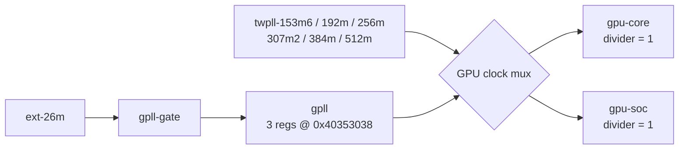
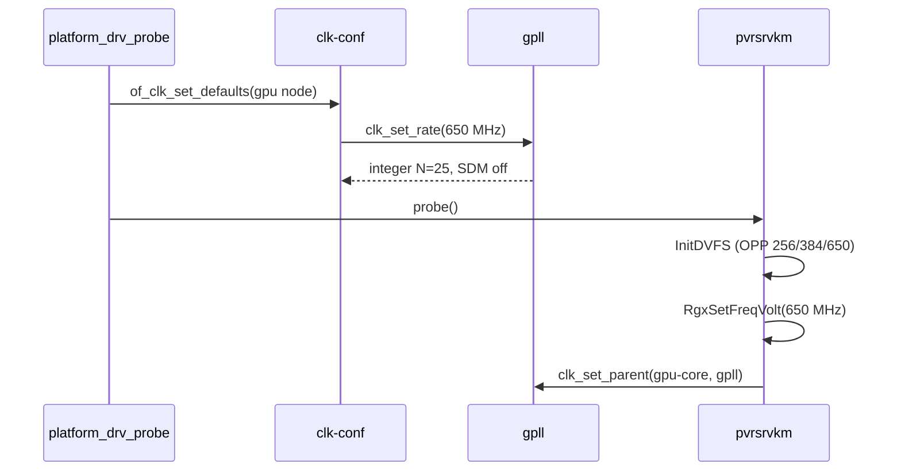

# GPU overclock — PowerVR Rogue GE8322 at 650 MHz

- **Device:** Samsung SM-A032F (Galaxy A03 Core)
- **SoC:** Unisoc SC9863A
- **GPU:** Imagination PowerVR Rogue GE8322, BVNC 22.86.104.218
- **Driver:** `pvrsrvkm`, Rogue DDK 1.18@6267915, vendor firmware unchanged
- **Method:** GPU OPP table + `assigned-clock-rates` on the GPU device-tree node
- **Status:** 650 MHz flashed and passed three 60 s stress runs; 700 MHz preview only

---

## 1. Result

| Metric | Stock | This patch |
|---|---:|---:|
| GPU OPP table | 256 / 384 / 550 MHz | 256 / 384 / **650 MHz** |
| GPU parent at top OPP | GPLL (index 9) | GPLL (index 9) |
| GPLL target | vendor default | **650 MHz** |
| GPU voltage | `vddcore` 900 mV (fixed) | `vddcore` 900 mV (fixed) |
| 20 s stress, 1024², 64-iteration shader | 147 frames / 7.31 fps | 160 frames / 7.97 fps (**+9.0 %**) |
| 60 s stress, same workload | not measured at 60 s | **489–509 frames / 8.15–8.47 fps** |
| GPU error counters | 0 | **0** |
| GPU temperature, 60 s | — | 59.0–59.9 °C max |
| CPU temperature, 60 s | — | 64.1–65.9 °C max |

The theoretical clock ratio is 650 / 550 = **+18.2 %**. The best 60 s run reached
**+15.9 %** over the 20 s stock baseline; the same-length 20 s A/B reached
**+9.0 %**. The difference is explained in [section 9](#9-measured-result).

Live state after flashing:

```text
/sys/class/devfreq/60000000.gpu/max_freq                 = 650000000
/sys/class/devfreq/60000000.gpu/available_frequencies    = 256000000 384000000 650000000
/sys/class/devfreq/60000000.gpu/governor                 = simple_ondemand
```

Driver log:

```text
opp[3/3]: (650000000 Hz, 0 uV)
```

---

## 2. Clock topology



| Item | Value |
|---|---|
| PLL provider | `sprd,sc9863a-pll` at `0x40353000` (`anlg_phy_g2_regs`) |
| Register offset | `0x38`, three 32-bit registers |
| `#clock-cells` | 1 |
| GPLL clock ID | `CLK_GPLL` = 23 (`0x17`) |
| GPU parent list | `twpll-153m6`, `twpll-192m`, `twpll-256m`, `twpll-307m2`, `twpll-384m`, `twpll-512m`, `gpll` |
| Top OPP parent index | 9 → `gpll` |
| GPU core/soc divider | 1 (vendor table) |

GPLL feeds only `gpu-core` and `gpu-soc` on this SoC. No other clock in the
SC9863A clock table uses `gpll` as a parent. The `gpll-gate` is registered with
`CLK_IGNORE_UNUSED`, so the late-init unused-clock cleanup does not gate it.

---

## 3. Why changing the OPP alone does nothing

The vendor `pvrsrvkm.ko` is unstripped, which made the DVFS path recoverable.
The relevant functions:

| Function | Address in `.ko` | Behavior |
|---|---:|---|
| `InitDVFS` | `0x97328` | Parses the OPP table with `dev_pm_opp_of_add_table`; falls back to `sprd,dvfs-lists` via `dev_pm_opp_add` |
| `devfreq_target` | `0x97bac` | Devfreq target callback |
| `RgxPowerOn` | `0xb4414` | Writes syscon power-domain registers only |
| `RgxClockOn` | `0xb45bc` | Enables clocks and calls `clk_set_parent` |
| `RgxSetFreqVolt` | `0xb48b4` | Binary-searches the custom table by kHz; calls `clk_set_parent` only |
| `SprdPrePowerState` | `0xb4af8` | Pre-power hook |
| `SprdPostPowerState` | `0xb4b80` | Post-power hook |

Key facts from the disassembly:

- The custom DVFS entry is 24 bytes: `+0` parent clock pointer, `+8` frequency
  in kHz, `+0xc` voltage in µV, `+0x10` flag.
- `RgxSetFreqVolt(freq_hz, voltage_uV)` looks up the entry by kHz and calls:
  - `clk_set_parent(gpu-core, parent)`
  - `clk_set_parent(gpu-soc, parent)`
- It **ignores** the voltage argument.
- The module imports `clk_disable`, `clk_enable`, `clk_prepare`,
  `clk_set_parent`, `clk_unprepare`, `of_clk_get`, and
  `of_clk_get_parent_count`.
- It does **not** import `clk_set_rate` or any regulator symbol.
- `RgxClockOn` enables clocks and reparents them; `RgxPowerOn` only touches
  power-domain syscons. Neither programs a PLL rate, a divider, or a regulator.

So the 650 MHz OPP changes the **label** the driver uses. The mux still selects
`gpll`, and `gpll` is still running at its old rate. The GPU does not speed up
until GPLL is reprogrammed separately.

---

## 4. The trick: program GPLL before the GPU driver probes

Add two properties to the GPU node:

```dts
assigned-clocks = <&gpll CLK_GPLL>;
assigned-clock-rates = <650000000>;
```

The GPU is a platform device matching `sprd,rogue`. On this kernel,
`platform_drv_probe()` calls `of_clk_set_defaults(dev->of_node, false)` before
the driver's probe. `of_clk_set_defaults()` walks `assigned-clocks` and
`assigned-clock-rates` and calls `clk_set_rate()` for each rate.



Why this is the safest available point:

- GPLL is programmed **before** `pvrsrvkm` enables or reparents its clocks.
- No other peripheral is clocked from GPLL.
- The `gpll-gate` is not gated by the unused-clock cleanup.
- A `clk_set_rate` failure is not fatal to probe: `of_clk_set_defaults()` logs
  the error and returns 0 for a failed rate write, so the GPU still probes. In
  the common case the 650 OPP then runs at the old GPLL rate; the fps check
  catches it.

The property is on the **PLL provider**, not on the gate:

```dts
/* decompiled numeric form */
assigned-clocks = <0x06 0x17>;       /* phandle 0x06 = gpll, clock 0x17 = CLK_GPLL */
assigned-clock-rates = <0x26be3680>; /* 650,000,000 */
```

The GPU node's existing `clocks` property already ends with the same
`<0x06 0x17>` pair, so the `assigned-clocks` entry refers to a clock the node
already consumes.

---

## 5. GPLL math

GPLL is defined as:

```c
SPRD_PLL_WITH_ITABLE_K_FVCO(gpll_clk, "gpll", "gpll-gate", 0x38,
                            3, ftable, f_gpll, 240,
                            1000, 1000, 1, 400000000);
```

| Parameter | Value |
|---|---|
| Reference | 26 MHz |
| Registers | 3 |
| `udelay` | 240 µs |
| `k1`, `k2` | 1000, 1000 |
| `fflag` | 1 |
| `fvco` threshold | 400 MHz |
| `ftable` ibias | 0 up to 1 GHz, 1 up to 1.2 GHz, 2 up to 1.4 GHz, 3 up to 1.6 GHz |

Computed with the same algorithm as `_sprd_pll_set_rate`:

| Target | Divider equation | Mode | N | K (23-bit) | ibias | Register 0 | Register 1 | Register 2 | Overclock |
|---|---|---|---:|---:|---:|---|---|---|---:|
| 550 MHz (stock) | 21 + 4/26 | SDM | 21 | `0x13B13B` | 0 | `0x00000005` | `0x0A93B13B` | `0x00000000` | — |
| **650 MHz** | **25** | **integer** | **25** | — | **0** | **`0x00001900`** | **not written** | **`0x00000000`** | **+18.18 %** |
| 700 MHz (preview) | 26 + 24/26 | SDM | 26 | `0x762762` | 0 | `0x00000005` | `0x0D762762` | `0x00000000` | +27.27 % |

Register layout:

| Register | Bits | Field |
|---|---|---|
| 0 | 0 | `div_s` |
| 0 | 1 | `mod_en` (preserved by the write mask) |
| 0 | 2 | `sdm_en` |
| 0 | 6–7 | `ibias` |
| 0 | 8–18 | `N` |
| 1 | 0–22 | `kint` |
| 1 | 23–29 | `nint` |
| 2 | 16 | `postdiv` |

For 650 MHz the integer path writes register 0 with `N = 25`, clears `div_s`
and `sdm_en`, and writes register 2 with `postdiv = 0`. Register 1 is not
written because SDM is off.

The fractional-divider formula used by the kernel:

```text
nint = floor(fvco / (refin * 1e6))
rem  = fvco mod (refin * 1e6)
kint = round(rem * 2^23 / (refin * 1e6))
```

For 550 MHz: `rem = 4 MHz`, `kint = 0x13B13B`. For 700 MHz: `rem = 24 MHz`,
`kint = 0x762762`.

The helper [`scripts/gpll_regs.py`](../scripts/gpll_regs.py) reproduces this
table and can check arbitrary targets:

```sh
python3 scripts/gpll_regs.py 550 650 700
```

> The PLL driver does **not** poll the lock-done bit. It write-checks the
> masked values and waits 240 µs. A configuration that writes cleanly but does
> not lock is not reported as an error. The stress test is the real lock test.

---

## 6. The 650 MHz device-tree patch

```diff
--- a/fdt.dts
+++ b/fdt.dts
@@ gpu@60000000 @@
-				operating-points = <0x3e800 0x00 0x5dc00 0x00 0x86470 0x00>;
-				sprd,dvfs-lists = <0x3e800 0x00 0x05 0x01 0x5dc00 0x00 0x07 0x01 0x86470 0x00 0x09 0x01>;
+				operating-points = <0x3e800 0x00 0x5dc00 0x00 0x9eb10 0x00>;
+				sprd,dvfs-lists = <0x3e800 0x00 0x05 0x01 0x5dc00 0x00 0x07 0x01 0x9eb10 0x00 0x09 0x01>;
 				sprd,dvfs-default = <0x00>;
 				sprd,dvfs-scene-extreme = <0x02>;
 				sprd,dvfs-scene-high = <0x01>;
@@
 				sprd,dvfs-range-max = <0x02>;
 				sprd,dvfs-range-min = <0x00>;
+				assigned-clocks = <0x06 0x17>;
+				assigned-clock-rates = <650000000>;
 				clocks = <0x05 0x4c 0x13 0x27 0x13 0x28 0x06 0x0f 0x06 0x03 0x06 0x09 0x06 0x0c 0x06 0x02 0x06 0x08 0x06 0x17>;
 				phandle = <0xf4>;
```

Decoded:

| Hex | Decimal | Meaning |
|---:|---:|---|
| `0x3e800` | 256,000 | 256 MHz OPP |
| `0x5dc00` | 384,000 | 384 MHz OPP |
| `0x9eb10` | 650,000 | 650 MHz OPP (replaces `0x86470` = 550,000) |
| `0x09` | 9 | GPLL parent index |
| `0x06` | — | GPLL provider phandle |
| `0x17` | 23 | `CLK_GPLL` |
| `0x26be3680` | 650,000,000 | `assigned-clock-rates` |

The OPP count and parent indices are unchanged. The 650 entry still uses index
9 → `gpll`. The focused diff is in
[`patches/gpu-650mhz.diff`](../patches/gpu-650mhz.diff).

If you are editing a **decompiled binary FDT**, use the numeric form:

```sh
fdtput -t x work/fdt.dtb /soc/mm/gpu@60000000 \
  operating-points 0x3e800 0 0x5dc00 0 0x9eb10 0
fdtput -t x work/fdt.dtb /soc/mm/gpu@60000000 \
  sprd,dvfs-lists 0x3e800 0 0x05 0x01 0x5dc00 0 0x07 0x01 0x9eb10 0 0x09 0x01
fdtput -t x work/fdt.dtb /soc/mm/gpu@60000000 \
  assigned-clocks 0x06 0x17
fdtput -t x work/fdt.dtb /soc/mm/gpu@60000000 \
  assigned-clock-rates 0x26be3680
```

`fdtput` replaces the whole property, so include every value. The property
names are case-sensitive and the commas are part of the name.

---

## 7. Build and flash

The full procedure is in [BUILD-AND-FLASH.md](BUILD-AND-FLASH.md). The GPU-only
path, starting from a known-good CPU-overclock image:

```sh
# 1. Extract the live FDT from the selected boot image.
python3 scripts/unpack_boot.py \
  --image boot-cpu.img --outdir work

# 2. Patch the four GPU properties in the binary FDT.
fdtput -t x work/fdt.dtb /soc/mm/gpu@60000000 \
  operating-points 0x3e800 0 0x5dc00 0 0x9eb10 0
fdtput -t x work/fdt.dtb /soc/mm/gpu@60000000 \
  sprd,dvfs-lists 0x3e800 0 0x05 0x01 0x5dc00 0 0x07 0x01 0x9eb10 0 0x09 0x01
fdtput -t x work/fdt.dtb /soc/mm/gpu@60000000 \
  assigned-clocks 0x06 0x17
fdtput -t x work/fdt.dtb /soc/mm/gpu@60000000 \
  assigned-clock-rates 0x26be3680

# 3. Pack the DTBO and boot image.
python3 scripts/pack_dtbo.py \
  --image boot-cpu.img --fdt work/fdt.dtb --out boot-cpu-gpu650.img

# 4. Verify before flashing.
python3 scripts/verify_boot.py --image boot-cpu-gpu650.img
```

The packer:

- writes a big-endian DTBO header (`d7 b7 ab 1e`);
- writes one entry at `0x20`, payload at `0x40`;
- clears the old container tail;
- updates `dtb_size` at `0x670`;
- leaves the boot-image `id` at `0x240` untouched;
- leaves kernel and ramdisk byte-identical.

---

## 8. Verification

After reboot:

```sh
# OPP table and live frequency (root).
su -c 'cat /sys/class/devfreq/60000000.gpu/max_freq'
su -c 'cat /sys/class/devfreq/60000000.gpu/available_frequencies'
su -c 'cat /sys/class/devfreq/60000000.gpu/cur_freq'
su -c 'cat /sys/class/devfreq/60000000.gpu/trans_stat'

# Driver and firmware health.
su -c 'cat /proc/pvr/status'

# DVFS label (OPP label, not a measured GPLL read).
su -c 'cat /proc/pvr/gpu00/debug_dump' | grep -i 'RGX DVFS'

# Boot log: look for the OPP and any GPLL/clock errors.
su -c 'dmesg' | grep -iE 'gpll|clk|pvr|rgx|opp' | tail -60
```

Expected:

- `max_freq = 650000000`
- `available_frequencies = 256000000 384000000 650000000`
- `cur_freq = 256000000` at idle
- `/proc/pvr/status`: `Driver Status: OK`, `Firmware Status: OK`, zero
  HWR / CRR / SLR / WGP / TRP / FWF errors
- no GPLL or clock-framework errors in `dmesg`
- `trans_stat` shows dwell time in the 650 MHz row under load

The driver log line `opp[3/3]: (650000000 Hz, 0 uV)` confirms that the OPP
table was parsed. It does **not** prove that GPLL moved; the fps delta and the
650 MHz dwell time are the practical evidence.

### Why there is no direct GPLL read

The following are unavailable on this kernel/device:

- `debugfs` clock summary (`CONFIG_DEBUG_FS` is not enabled; `mount -t debugfs`
  returns `ENODEV`);
- `/dev/mem`, `/dev/kmem`, `/proc/kcore`;
- readable kernel pointers (`kptr_restrict=2`).

`/proc/pvr/gpu00/debug_dump` and `firmware_trace` report the OPP frequency, not
a measured GPLL rate. The GPU driver imports no `clk_get_rate`. Validation is
therefore indirect: performance delta plus stability.

---

## 9. Measured result

### 9.1 Stress workload

`gpu_stress.c` creates an EGL pbuffer + GLES2 context, draws a 1024 × 1024
full-screen quad with a heavy fragment shader (64 iterations), and samples GPU
frequency, GPU/CPU temperature, `vddcore`, and DDR frequency every 100 ms. It
is read-only with respect to the phone: it renders to its own pbuffer and only
reads sysfs/procfs.

Build and run on the phone:

```sh
clang -O2 -pthread -o gpu_stress gpu_stress.c -ldl
su -c './gpu_stress -d 60 -s 1024 -i 64 -b 2'
```

### 9.2 A/B at the same run length (20 s)

| Configuration | Frames | fps | Delta |
|---|---:|---:|---:|
| Stock 550 MHz | 147 | 7.31 | — |
| 650 MHz | 160 | 7.97 | **+9.0 %** |

This is the cleanest comparison because both runs use the same 20 s duration
and the same workload.

### 9.3 60 s runs at 650 MHz

| Run | Frames | fps | GPU max | CPU max | GPU errors |
|---|---:|---:|---:|---:|---:|
| 1 (earlier session) | 509 | **8.47** | 52.6 °C | 56.1 °C | 0 |
| 2 (fresh log) | 489 | 8.15 | 59.9 °C | 65.9 °C | 0 |
| 3 (fresh log) | 502 | 8.36 | 59.0 °C | 64.1 °C | 0 |

Raw logs: [`results/logs/gpu_650_60s_run2.log`](../results/logs/gpu_650_60s_run2.log)
and [`results/logs/gpu_650_60s_run3.log`](../results/logs/gpu_650_60s_run3.log).

All three runs report:

```text
Driver Status:   OK
Firmware Status: OK
HWR Event Count: 0
CRR Event Count: 0
SLR Event Count: 0
WGP Error Count: 0
TRP Error Count: 0
FWF Event Count: 0
```

`APM Event Count` is not an error counter; it increments with normal GPU
activity.

After run 3, `trans_stat` showed 174 total transitions and **400,524 ms** of
dwell in the 650 MHz state. The GPU stayed at 650 MHz for the entire load
window; the idle state is 256 MHz.

### 9.4 Why the gain is not the full 18.2 %

The GPU core clock ratio is 650 / 550 = 1.182, but the draw path is not purely
GPU-bound:

- the EGL/GLES submission and the stress tool's frame loop run on the CPU;
- the CPU hits the 65 °C thermal table during a 60 s run, which drops the big
  cluster to 1.6 GHz and the little cluster to 1.2 GHz;
- the GPU workload has memory and driver overhead that does not scale with the
  core clock;
- run-to-run spread on Android is about 2–4 %.

The expected pure-clock number is `7.31 × 650/550 = 8.64 fps`. The best 60 s
run (8.47) is **98 %** of that; the fresh runs (8.15–8.36) are **94–97 %**. The
same-length 20 s run (7.97) is **92 %**. This is consistent with a real 650 MHz
clock plus a CPU-side ceiling, not with a failed overclock.

### 9.5 Real-world expectation

The synthetic shader is ALU-heavy. Games are more memory- and
bandwidth-bound, so the fps gain in a real game will usually be smaller than
the synthetic number. A 5–15 % gain in GPU-limited scenes is a realistic
expectation; CPU-limited scenes will not improve.

---

## 10. 700 MHz preview (not enabled)

The same mechanism can target 700 MHz, but 700 MHz needs SDM and has less
timing margin at the fixed 900 mV `vddcore`.

| Property | 650 MHz | 700 MHz |
|---|---:|---:|
| `operating-points` value | `0x9eb10` | `0xaae60` |
| `sprd,dvfs-lists` value | `0x9eb10 0 0x09 0x01` | `0xaae60 0 0x09 0x01` |
| `assigned-clock-rates` | `650000000` (`0x26be3680`) | `700000000` (`0x29b92700`) |
| GPLL mode | integer, N = 25 | SDM, N = 26, K = `0x762762` |
| Register 1 | not written | `0x0D762762` |
| Overclock vs 550 | +18.2 % | +27.3 % |

Do not enable 700 MHz until:

1. 650 MHz has passed at least **3 × 60 s** with zero error counters (done);
2. the device is cool at the start of each run and the GPU stays below 70 °C;
3. you have a rollback image and a recovery path;
4. you accept that there is no voltage margin to recover a weak sample.

If 650 MHz is marginal on your device, 700 MHz will be worse. The preview diff
is in [`patches/gpu-700mhz-preview.diff`](../patches/gpu-700mhz-preview.diff);
it is documentation, not a recommendation.

---

## 11. Voltage and thermal limits

| Rail | Voltage | State | Users | Notes |
|---|---:|---|---:|---|
| `vddcore` (`regulator.2`, `DCDC_CORE`) | 900,000 µV | enabled | 0 | closest rail to the GPU; no GPU supply phandle |
| `vddcpu` | 1,250,000 µV | — | 0 | CPU rail |
| `vddmem` | 1,400,000 µV | — | 0 | memory rail |

There is no `vddgpu` rail. The GPU node has no `*-supply` property. The GPU
driver imports no regulator symbols and does not call
`regulator_set_voltage`. The OPP table's voltage column is zero and
`RgxSetFreqVolt` ignores it.

Consequences:

- The GPU runs at the bootloader/PMIC-established `vddcore` (900 mV).
- There is no supported way to raise GPU voltage from userspace or from the
  current driver.
- A voltage bump would require adding a supply to the GPU node and calling the
  regulator API, or changing the PMIC default. `vddcore` is a shared core rail;
  raising it affects other logic and is out of scope.

Thermal guidance:

| Reading | Normal | Warning | Abort |
|---|---:|---:|---:|
| GPU temperature | < 60 °C | 60–70 °C | > 70 °C |
| CPU temperature | < 65 °C | 65–75 °C | > 80 °C |
| GPU error counters | 0 | any increase | rollback |

The 650 MHz runs peaked at 59.9 °C GPU and 65.9 °C CPU. The CPU thermal table
engages at 65 °C, which is why the 60 s fps curve declines after about 20 s.

---

## 12. Risks and abort criteria

| Risk | Likelihood | Impact | Mitigation |
|---|---|---|---|
| GPU timing failure at 650 MHz / 900 mV | medium | corruption, hang, app crash, reboot | 3 × 60 s stress; check `/proc/pvr/status`; rollback on any anomaly |
| GPLL fails to lock | low | GPU hang on first use; possible boot-time graphics failure | reboot; rollback via boot partition; no other peripheral uses GPLL |
| GPLL rate write rejected | low | no overclock; 650 OPP runs at old rate | check fps delta and `trans_stat`; not dangerous |
| Boot image fails to boot | low | no Android UI | keep stock/v4 images on host and phone; download mode/Odin |
| Thermal | low | 60 °C GPU expected; no throttle at 550 | monitor; abort above 70 °C |
| Shared `vddcore` side effects | n/a in this plan | no voltage change is made | do not attempt a voltage bump without a separate design review |
| Data corruption from a hung GPU | low | filesystem/app data risk | back up important data; reboot after a hang; `fsck` if needed |

Roll back immediately if any of the following occurs:

- no display, boot loop, or kernel panic;
- GPU hang, repeated app crashes, or visible rendering corruption;
- HWR, CRR, SLR, WGP, TRP, or FWF counters increase;
- GPU temperature above 70 °C;
- fps below the 550 MHz baseline;
- any GPLL/clock-framework error in `dmesg`.

---

## 13. Gotchas

| Symptom | Likely cause | Fix |
|---|---|---|
| `max_freq=650000000` but fps unchanged | `assigned-clock-rates` not applied, wrong phandle/clock ID, or GPLL write rejected | Check the DTS path and `clocks` property; verify the fps delta; inspect `dmesg` |
| `assigned-clock-rates` property missing after repack | `fdtput` failed or you edited the wrong node | Use `fdtdump`/`fdtget` on the packed FDT; node is `/soc/mm/gpu@60000000` |
| `max_freq` still 550000000 | OPP property not replaced, or old DTBO still active | Check `dtb_size`, DTBO magic, and that the boot partition hash changed |
| GPU works but 650 OPP never selected | `sprd,dvfs-range-max` or scene mapping still points at index 1 | Keep `sprd,dvfs-range-max = <0x02>` and `sprd,dvfs-scene-extreme = <0x02>` |
| Bootloader ignores the new tree | DTBO header byte-swapped | First four bytes must be `d7 b7 ab 1e` |
| Debugfs clock read fails | `CONFIG_DEBUG_FS` disabled | Use fps + `trans_stat`; do not chase a direct read |
| `cat /sys/class/devfreq/...` permission denied | sysfs is root-only | Run through `su -c` |
| APM counter grows | normal GPU activity, not an error | Ignore it; watch HWR/CRR/SLR/WGP/TRP/FWF |
| Phone heats and fps drops after ~20 s | CPU 65 °C thermal table | Cool the device, shorten the run, or accept the fallback |

---

## 14. Checklist

- [ ] Read the disclaimer and confirm an unlocked bootloader + recovery path.
- [ ] Stock boot image dumped, hashed, and copied off the phone.
- [ ] CPU image (or stock image) verified and kept as rollback.
- [ ] GPU node located at `/soc/mm/gpu@60000000`.
- [ ] `operating-points` third entry changed to `0x9eb10`.
- [ ] `sprd,dvfs-lists` third entry changed to `0x9eb10 0 0x09 0x01`.
- [ ] `assigned-clocks = <0x06 0x17>` added.
- [ ] `assigned-clock-rates = <650000000>` added.
- [ ] Parent index still 9 (GPLL).
- [ ] DTBO magic is `d7 b7 ab 1e`.
- [ ] Kernel and ramdisk hashes unchanged.
- [ ] `max_freq = 650000000`.
- [ ] `available_frequencies` includes 650 MHz.
- [ ] `/proc/pvr/status` shows zero errors.
- [ ] 3 × 60 s stress runs clean.
- [ ] `trans_stat` shows 650 MHz dwell under load.
- [ ] Rollback image still on the phone and on the host.
- [ ] 700 MHz left disabled until a voltage/timing plan exists.
